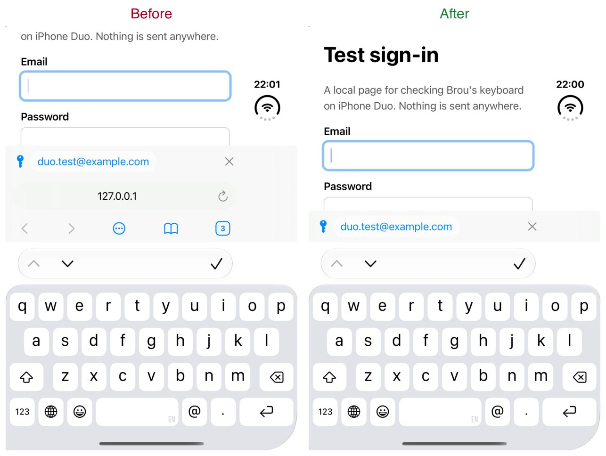
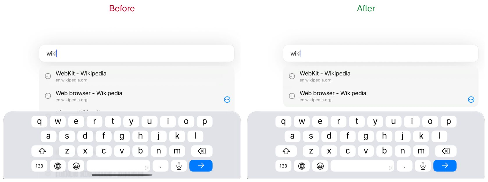
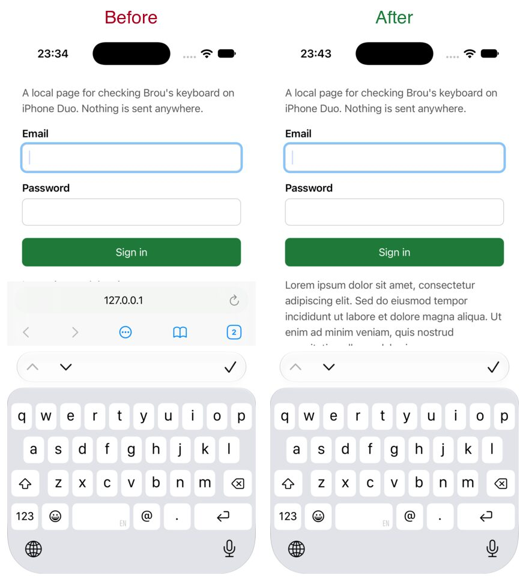
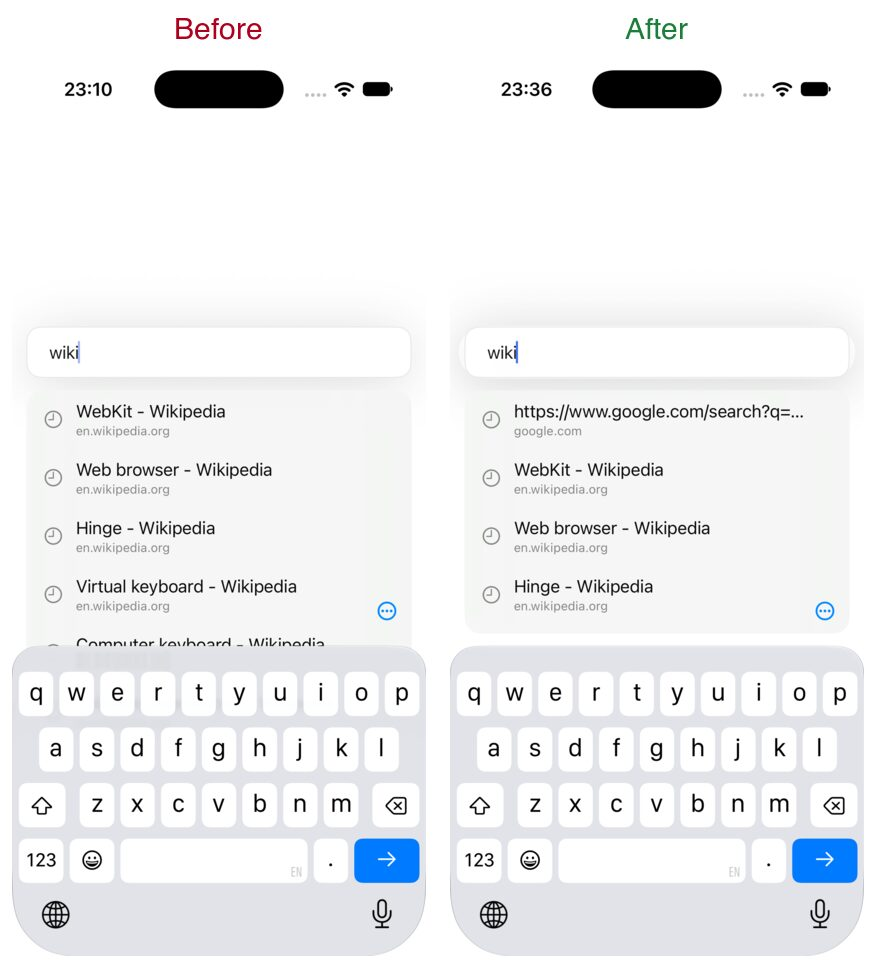

# iPhone Duo: the keyboard

23 October 2026. iPhone Duo went on sale that day with iOS 27.1.

## The device, from Apple

- A foldable iPhone with two screens of the same aspect ratio: 5.4 inches outside, 7.6 inches inside ([press release](https://www.apple.com/newsroom/2026/09/apple-unveils-iphone-duo/)). In the iOS 27.1 simulator the outer screen is 466 × 678 points, wider and shorter than other iPhones.
- Outer screen: compact width, regular height in portrait; compact both ways on its side. Inner screen: regular both ways, so Brou shows its sidebar layout there, as on iPad ([Prepare your app for iPhone Duo](https://developer.apple.com/videos/play/tech-talks/111461/)).
- The status bar, the camera and the Dynamic Island sit on one side, so safe areas are asymmetric. The hinge is a reserved region when the device is partly folded ([HIG: Designing for iPhone Duo](https://developer.apple.com/design/human-interface-guidelines/designing-for-iphone-duo), [Preparing your app for iPhone Duo](https://developer.apple.com/documentation/technologyoverviews/preparing-your-app-for-iphone-duo)).
- Apple asks for layouts built from size classes, safe areas and the container's size, never fixed widths or the main screen. Bars made by the app stay where the app puts them. Accessory bars stay attached to the keyboard ([Raise the bar with iPhone Duo](https://developer.apple.com/videos/play/tech-talks/111462/)).
- Built with an SDK older than iOS 27.1, an app runs on iPhone Duo in a compatibility frame beside the status bar. Build with Xcode 27.1.

## What was wrong

On the outer screen, typing in a page's own field left the page about a third of the screen. Brou's address field and five buttons rode up over the keyboard and WebKit's form bar. On its side, the page had about 100 points, less than Brou's bar. The start page's suggestions ran on under the keyboard.

## What changed

- iPhone layout (compact width): while the keyboard is up for the page, not for Brou's field, the address field and buttons step aside, as Safari's do. The sign-in strip stays, now right over the keyboard. Everything comes back when the keyboard goes. Brou learns this from the keyboard's will-show and will-hide notifications and from its own field's focus. There are no screen sizes or model checks.
- Suggestions show whole when they fit, and scroll when the keyboard leaves less room.
- On the start page, the suggestions stop at the keyboard. Their height comes from the field's place in the space the keyboard leaves.
- The sidebar layout (iPad, iPhone Duo open) is unchanged apart from scrolling suggestions.

With a hardware keyboard, iOS shows only WebKit's form bar, and Brou's bar stays: there is room for both (seen in the iPhone Duo simulator).

## Verification

Every build was made with Xcode 27.1 and signed ad hoc for the simulator.

iPhone Duo simulator, iOS 27.1, outer screen. Pages were a GitHub sign-in page and a local test page; the account was made up and kept only in the simulator.

- Portrait and on its side: a page's sign-in form with the keyboard up.
- The sign-in strip over the keyboard, and filling from it.
- Switching from Brou's field straight to a page's field: the bar steps aside.
- Brou's own field: the bar stays over the keyboard.
- Done: the keyboard goes and the bar comes back.
- Start-page suggestions, portrait and on its side.

| A page's sign-in form | On its side |
| --- | --- |
|  |  |

| The sign-in strip | Start-page suggestions on its side |
| --- | --- |
|  |  |

iPhone 17 simulator, iOS 27.0, the same build: a page's sign-in form with the keyboard up, and the start-page suggestions. On a normal iPhone the bar took less of the screen, but the fault was the same. Done, the sign-in strip and landscape were not repeated there: the simulator kept freezing on a heavily loaded Mac. The iPhone layout is one code path for every iPhone, with no model checks.

| iPhone 17: a page's sign-in form | iPhone 17: start-page suggestions |
| --- | --- |
|  |  |

Not checked here: the inner screen in the simulator (Device Hub's open and fold controls are in its window only), the folded pose, and a physical iPhone Duo.

## Not in this change

Brou's bottom bar is its own view, so iOS doesn't move it to the side on the outer screen as it does with system toolbars. Moving to system toolbars would be a larger, separate change.
