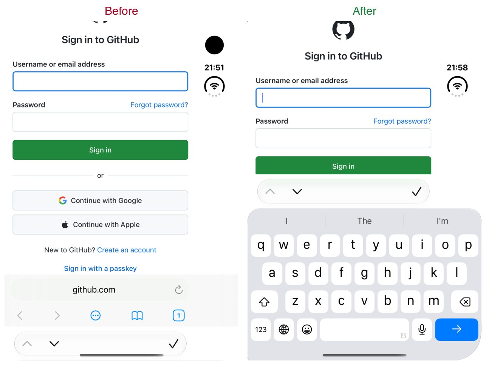
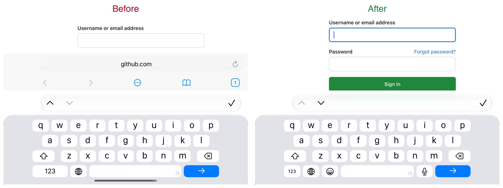
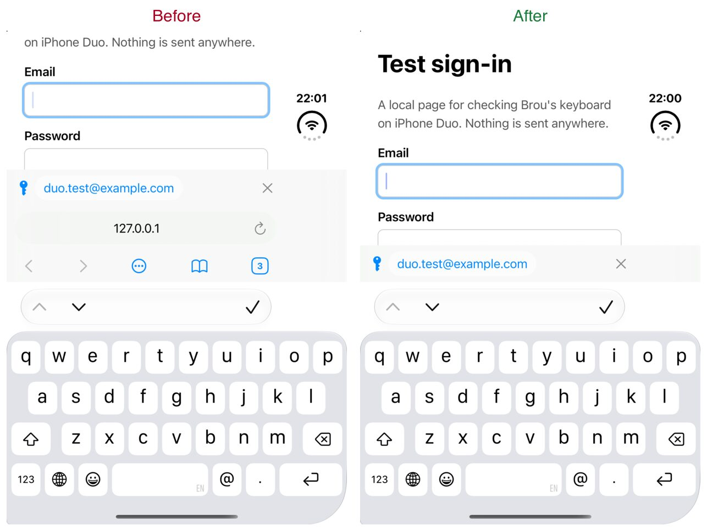
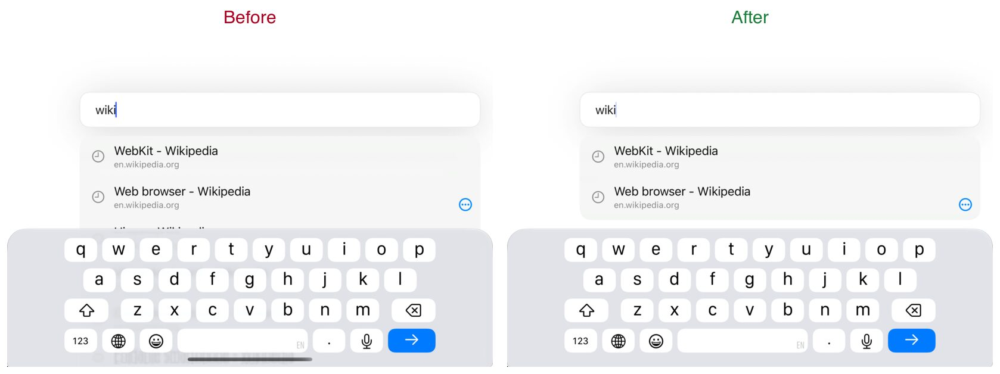
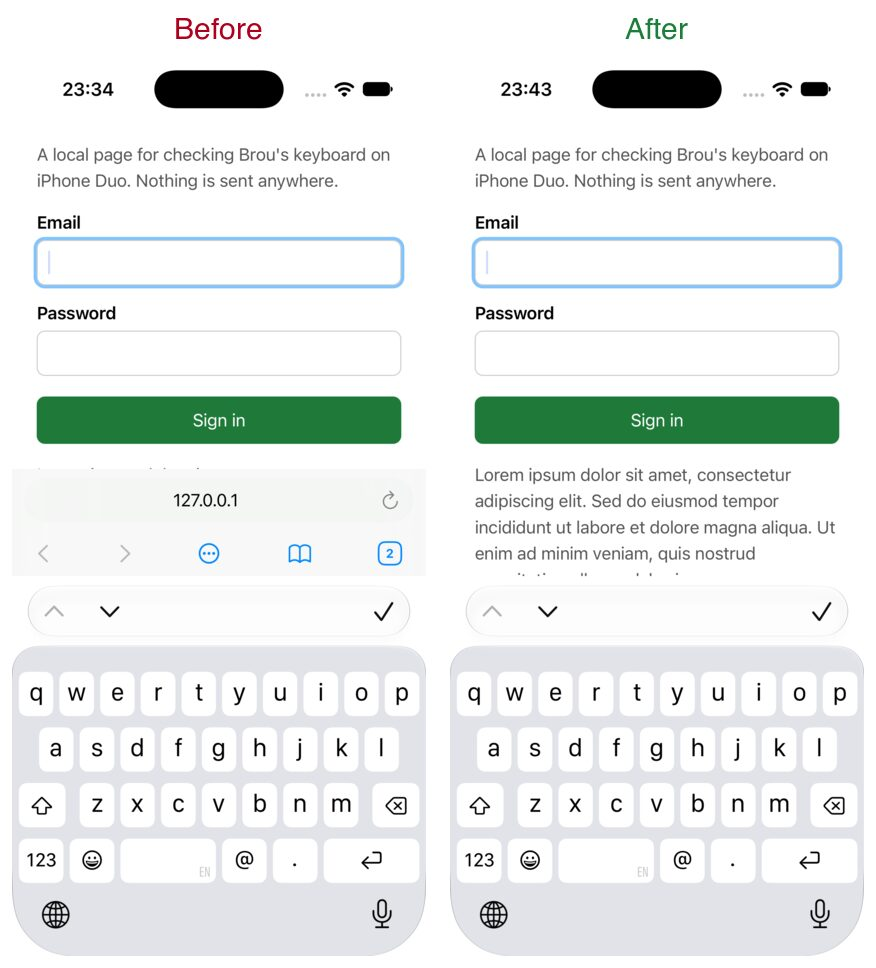
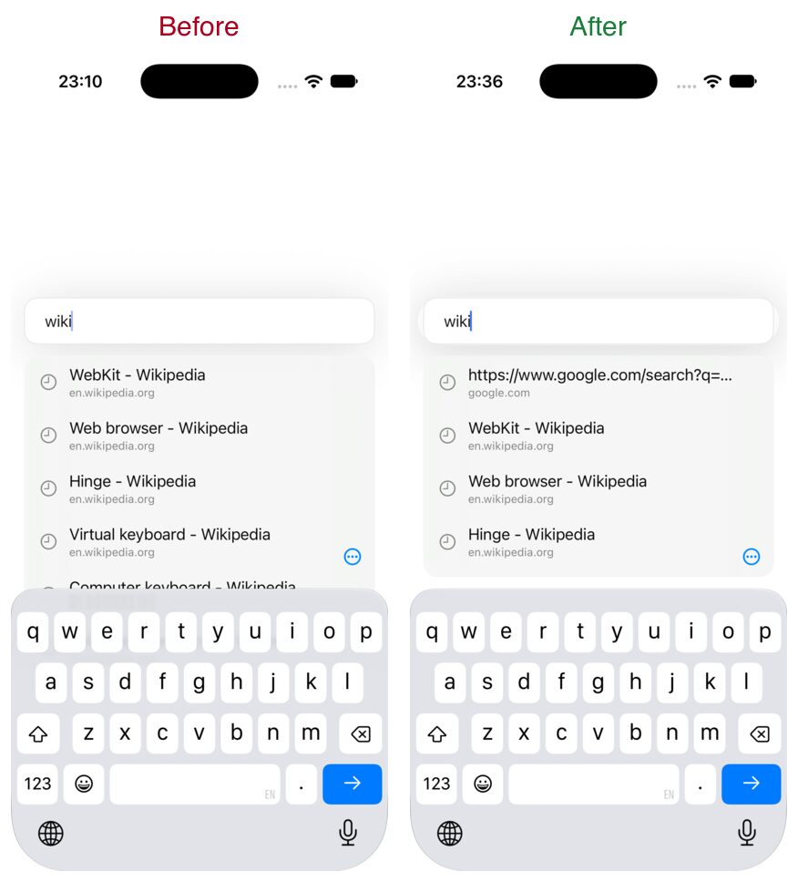
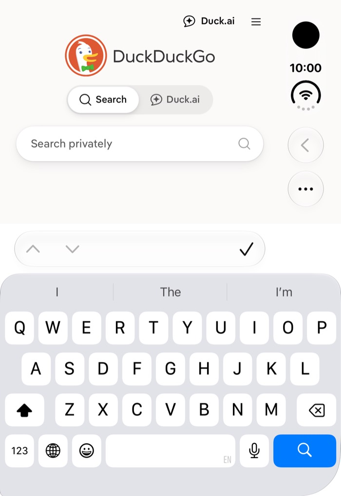

# iPhone Duo: the bars and the keyboard

23 October 2026, iPhone Duo's launch day with iOS 27.1; the bars on 2 November 2026.

## The device, from Apple

- A foldable iPhone with two screens of the same aspect ratio: 5.4 inches outside, 7.6 inches inside ([press release](https://www.apple.com/newsroom/2026/09/apple-unveils-iphone-duo/)). In the iOS 27.1 simulator the outer screen is 466 × 678 points, wider and shorter than other iPhones.
- Outer screen: compact width, regular height in portrait; compact both ways on its side. Inner screen: regular both ways, so Brou shows its sidebar layout there, as on iPad ([Prepare your app for iPhone Duo](https://developer.apple.com/videos/play/tech-talks/111461/)).
- The status bar, the camera and the Dynamic Island sit on one side, so safe areas are asymmetric. The hinge is a reserved region when the device is partly folded ([HIG: Designing for iPhone Duo](https://developer.apple.com/design/human-interface-guidelines/designing-for-iphone-duo), [Preparing your app for iPhone Duo](https://developer.apple.com/documentation/technologyoverviews/preparing-your-app-for-iphone-duo)).
- Apple asks for layouts built from size classes, safe areas and the container's size, never fixed widths or the main screen. On the outer screen, and open on its side, iOS lays the system's bars along one side; icon items marked `.axisBehavior(.verticalPreferred)` go there, and `toolbarVerticalEdge` says when they can. Bars made by the app stay where the app puts them. Accessory bars stay attached to the keyboard ([Raise the bar with iPhone Duo](https://developer.apple.com/videos/play/tech-talks/111462/)).
- Built with an SDK older than iOS 27.1, an app runs on iPhone Duo in a compatibility frame beside the status bar. Build with Xcode 27.1.

## What was wrong

On the outer screen, typing in a page's own field left the page about a third of the screen. Brou's address field and five buttons rode up over the keyboard and WebKit's form bar. On its side, the page had about 100 points, less than Brou's bar. The start page's suggestions ran on under the keyboard.

On his iPhone Duo, Victor then found:

- Closed, Brou's buttons stayed in its own bar under the page, not in the new bar along the side.
- The page ran on under the clock's column, so its scroll bar showed in the middle of the text; on its side, that column was a wide black band.
- Open on its side, the bar along the top sat against the screen's edge.
- After turning the phone, Brou's bar could vanish for good: iOS reported a keyboard with the old orientation's frame and never that it hid.

## What changed

- iPhone layout (compact width): while the keyboard is up for the page, not for Brou's field, the address field and buttons step aside, as Safari's do. The sign-in strip stays, now right over the keyboard. Everything comes back when the keyboard goes. Brou learns this from the keyboard's will-show and will-hide notifications and from its own field's focus. There are no screen sizes or model checks.
- Suggestions show whole when they fit, and scroll when the keyboard leaves less room.
- On the start page, the suggestions stop at the keyboard. Their height comes from the field's place in the space the keyboard leaves.
- Where iOS has a vertical bar (iPhone Duo closed, and open on its side), Brou's buttons are system toolbar items in it: back at the top, then forward, bookmarks, tabs with a badge, and the menu; open, back, forward, New Tab and the menu. Back and the menu are the last to give way, and each has a title for the bar's overflow. Brou's own bar then holds only the field. Where iOS has no vertical bar, nothing changes.
- The page, its text and its scroll bar stay inside the safe area. Beside it, in the clock's column and under the home bar, the page's container shows the colour of the page's top instead of black.
- Open, the bar along the top keeps clear of the screen's corners: level with the clock beside the page, and short of the camera's corner when upright.
- Whether the keyboard is up comes from UIKit's keyboard layout guide, laid out with the view in the orientation on screen, not from the keyboard notices.
- The sidebar layout (iPad, iPhone Duo open upright) is otherwise unchanged apart from scrolling suggestions.

With a hardware keyboard, iOS shows only WebKit's form bar, and Brou's bar stays: there is room for both (seen in the iPhone Duo simulator).

## Verification

Every build was made with Xcode 27.1 and signed ad hoc for the simulator.

iPhone Duo simulator, iOS 27.1, outer screen. Pages were a GitHub sign-in page and a local test page; the account was made up and kept only in the simulator.

- Portrait and on its side: a page's sign-in form with the keyboard up.
- The sign-in strip over the keyboard, and filling from it.
- Switching from Brou's field straight to a page's field: the bar steps aside.
- Brou's own field: the bar stays over the keyboard.
- Done: the keyboard goes and the bar comes back.
- Start-page suggestions, portrait and on its side.

| A page's sign-in form | On its side |
| --- | --- |
|  |  |

| The sign-in strip | Start-page suggestions on its side |
| --- | --- |
|  |  |

iPhone 17 simulator, iOS 27.0, the same build: a page's sign-in form with the keyboard up, and the start-page suggestions. On a normal iPhone the bar took less of the screen, but the fault was the same. Done, the sign-in strip and landscape were not repeated there: the simulator kept freezing on a heavily loaded Mac. The iPhone layout is one code path for every iPhone, with no model checks.

| iPhone 17: a page's sign-in form | iPhone 17: start-page suggestions |
| --- | --- |
|  |  |

Not checked here: the inner screen in the simulator (Device Hub's open and fold controls are in its window only), the folded pose, and a physical iPhone Duo.

### The vertical bar, 2 November 2026

iPhone Duo simulator, iOS 27.1, outer screen, on a heavily loaded Mac: the start page, victorcorreal.com and DuckDuckGo.

- The buttons in the vertical bar, in portrait and on its side, where the bar moves beside the camera.
- Turning to its side and back: Brou's bar stays (it vanished before).
- Typing in DuckDuckGo's own field: Brou's bar steps aside, the vertical bar keeps Back and folds the rest into its overflow (Page, Forward, Bookmarks, Tabs). Done: everything comes back.
- Bookmarks from the vertical bar: the sheet keeps clear of the column.

iPhone 17 simulator, iOS 27.0, the same build: the bar and its five buttons as before; typing in DuckDuckGo's field, the bar steps aside and comes back.

| The vertical bar | On its side |
| --- | --- |
|  |  |

| Typing in a page's field | A dark page |
| --- | --- |
|  |  |

Not checked in the simulator: the inner screen, open or folded, since only Device Hub's window opens and folds the simulated device. Check it on the phone.
